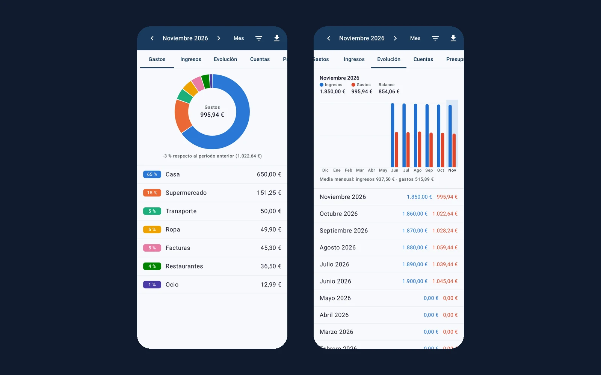

# MAConta

Contabilidad de casa en el móvil: apuntar gastos, ingresos y transferencias entre cuentas, ver saldos y estadísticas, y exportarlo todo a Excel. Los datos se guardan cifrados en el móvil y no se envían a internet.

**Aplicación gratuita para Android desarrollada por [Masoft.es](https://masoft.es)**

[](https://github.com/MaSoft/MAConta/releases/latest)

Más información y el manual también en [masoft.es](https://masoft.es/android.html#maconta).


## Características
- Movimientos en tres vistas, diario, calendario y mensual, con totales por día, semana y mes.
- Transferencias entre cuentas en un solo apunte, con la comisión como gasto.
- Estadísticas de gastos e ingresos por categoría, evolución de 12 meses, por cuenta y presupuestos.
- Tickets y facturas con la cámara: la foto se guarda y el movimiento se abre ya relleno para revisarlo.
- Pendientes: libreta de lo que te deben y de lo que debes, sin tocar los saldos.
- Recibos con cargo mensual, aviso antes de cada cargo y «Próximo mes» para calcular lo que vas a ingresar y gastar.
- Movimientos repetidos (recibos y nóminas que se apuntan solos), plantillas, calculadora en el importe y autocompletado.
- Exportación a Excel o CSV, copia automática diaria (se guardan 15) y copias manuales donde elijas.
- Base de datos cifrada, bloqueo opcional con huella o PIN, y tema claro u oscuro.

## Capturas

| | |
|---|---|
| <br>**Estadísticas.** Gastos por categoría con su porcentaje y evolución de ingresos y gastos mes a mes. | <br>**Recibos y mes actual.** Recibos con cargo mensual y su próximo cargo, y la calculadora del mes con recibos e ingresos fijos. |

## Requisitos

| | |
|---|---|
| Sistema | Android 13 o superior |
| Permisos | Huella o PIN solo si se activa el bloqueo, y red local para sincronizar con el PC. No envía nada a internet. |
| Instalación | Se descarga el APK en el móvil y se abre; Android pide permiso para instalar aplicaciones de esa fuente. |
| Actualizar | La versión nueva se instala encima de la anterior sin perder los datos. |

Funciona sola en el móvil. La sincronización con MAConta de escritorio, que el manual explica, es opcional y esa versión no se publica.

## Descarga y comprobación

En [Releases](https://github.com/MaSoft/MAConta/releases/latest) están la aplicación (`MAConta-1.5.0.apk`), su huella SHA-256 y el manual. Las aplicaciones no están en Google Play: se instalan desde el APK y Google Play Protect puede avisar de que no conoce la aplicación.

Para comprobar que la descarga está completa, en PowerShell:

```powershell
Get-FileHash .\MAConta-1.5.0.apk
```

Debe coincidir con `6a4bc3f7d43fa940b37f7f861e09f1f3c77403de551173330e2ec90c3af65ebf`.

## Manual

[manual_MAConta.html](https://github.com/MaSoft/MAConta/releases/latest/download/manual_MAConta.html): descárgalo y ábrelo en el navegador.

## Aviso legal

MAConta es gratuito y se entrega tal cual, sin garantía de ningún tipo. Al descargarlo y usarlo aceptas el aviso legal y las limitaciones de su manual.

> ⚠ MAConta es una herramienta de uso personal. Los cálculos dependen de los datos introducidos o importados; no sustituye a documentos bancarios ni tiene validez contable o fiscal.

**Limitaciones y exclusión de responsabilidad**
- Solo euros; no maneja varias monedas.
- Las copias .mcbak no están cifradas.
- La sincronización funciona en la red local (o una VPN a casa); no hay servidor en Internet.
- MAConta se proporciona tal cual, sin garantía de ningún tipo.

Este repositorio solo contiene la aplicación compilada y su documentación. © Masoft.es. Todos los derechos reservados.
