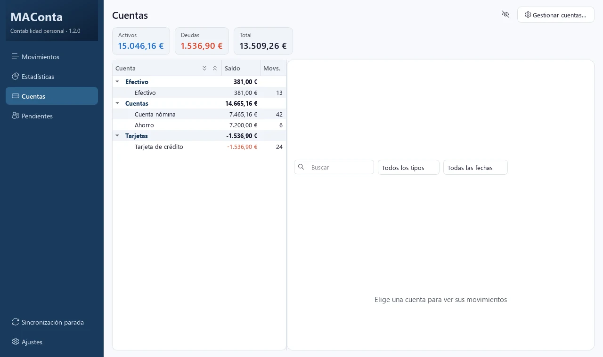
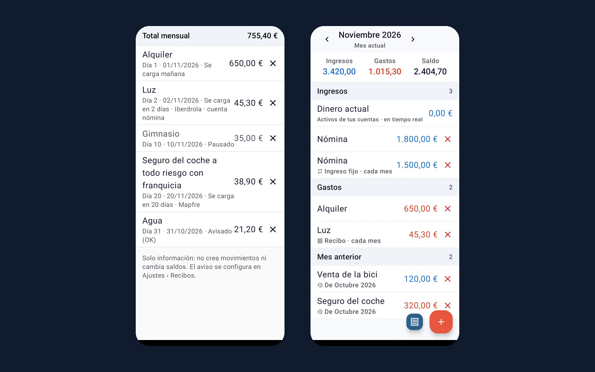

# MAConta

Contabilidad de casa en el móvil y en el ordenador: apuntar gastos, ingresos y transferencias entre cuentas, ver saldos y estadísticas, y exportarlo todo a Excel. Los datos se guardan cifrados y no se envían a internet.

**Aplicación gratuita para Windows y Android desarrollada por [Masoft.es](https://masoft.es)**

- **Windows 1.2.0:** [instalador](https://github.com/MaSoft/MAConta/releases/download/escritorio-v1.2.0/MAConta_Escritorio_Setup_v1.2.0.exe) o [ejecutable único](https://github.com/MaSoft/MAConta/releases/download/escritorio-v1.2.0/MAConta_v1.2.0.exe)
- **Android 1.5.0:** [APK](https://github.com/MaSoft/MAConta/releases/download/android-v1.5.0/MAConta-1.5.0.apk)

Más información y los manuales también en [masoft.es](https://masoft.es/descargas.html#maconta).

**Funcionan juntas.** El PC hace de servidor y el móvil se sincroniza con él por la red de casa: emparejados con un código QR, cifrado AES-256 y automático, sin cuentas ni nube. Cada una funciona también sola.

## Windows 1.2.0

**Windows 10 / 11 · 64 bits** · [Página de la versión](https://github.com/MaSoft/MAConta/releases/tag/escritorio-v1.2.0)

- **Instalador:** [`MAConta_Escritorio_Setup_v1.2.0.exe`](https://github.com/MaSoft/MAConta/releases/download/escritorio-v1.2.0/MAConta_Escritorio_Setup_v1.2.0.exe) · 44,5 MB · SHA-256 `529e003e3e856953c23f20f465b685073bbd7293368a64f5c611323745f04657`
- **Ejecutable único (sin instalar):** [`MAConta_v1.2.0.exe`](https://github.com/MaSoft/MAConta/releases/download/escritorio-v1.2.0/MAConta_v1.2.0.exe) · 67,4 MB · SHA-256 `33af30323e688c0a637bccd3a533514b7219de9f50b3dacaa64273fbec058666`

### Qué hace
- Diario, calendario y mensual con tablas grandes y ordenables, y resumen por semanas o meses.
- Ticket desde archivo: de una foto o un PDF, el OCR de Windows lee el total, la fecha, la hora y los datos del comercio.
- Importación de cualquier Excel o CSV de bancos y otras apps, con mapeo de columnas y perfiles.
- Estadísticas: anillo por categoría con subcategorías, barras de 12 meses y resumen por cuenta.
- Exportación a Excel, CSV e informe HTML interactivo, del periodo o de todo.
- Pendientes, copias automáticas diarias y manuales con los tickets, en el mismo formato que el móvil.
- Sincronización con el móvil emparejado por QR, cifrada y automática, con registro de conflictos.
- Tema claro u oscuro como Windows, y todos los datos en la carpeta del programa.

### Requisitos

| | |
|---|---|
| Sistema | Windows 10 u 11 (64 bits) |
| Instalación | Instalador para tu usuario, sin permisos de administrador, o ejecutable único que se copia y se abre; Python va dentro. |
| Pantalla | 1080 × 680 como mínimo |
| Con el móvil | PC y móvil en la misma red y el puerto 47850 (TCP y UDP) permitido en el cortafuegos para redes privadas. |

### Capturas

| | |
|---|---|
|  **Movimientos.** Tabla ordenable del mes con ingresos, gastos, total y botón para leer un ticket. |  **Estadísticas.** Gastos por categoría en anillo y en tabla, presupuestos y evolución de 12 meses. |
|  **Cuentas.** Saldos por grupo y por cuenta, con activos, deudas y total. |  |

## Android 1.5.0

**Android 13 o superior** · [Página de la versión](https://github.com/MaSoft/MAConta/releases/tag/android-v1.5.0)

- **APK:** [`MAConta-1.5.0.apk`](https://github.com/MaSoft/MAConta/releases/download/android-v1.5.0/MAConta-1.5.0.apk) · 58,7 MB · SHA-256 `6a4bc3f7d43fa940b37f7f861e09f1f3c77403de551173330e2ec90c3af65ebf`

### Qué hace
- Movimientos en tres vistas, diario, calendario y mensual, con totales por día, semana y mes.
- Transferencias entre cuentas en un solo apunte, con la comisión como gasto.
- Estadísticas de gastos e ingresos por categoría, evolución de 12 meses, por cuenta y presupuestos.
- Tickets y facturas con la cámara: la foto se guarda y el movimiento se abre ya relleno para revisarlo.
- Pendientes: libreta de lo que te deben y de lo que debes, sin tocar los saldos.
- Recibos con cargo mensual, aviso antes de cada cargo y «Próximo mes» para calcular lo que vas a ingresar y gastar.
- Movimientos repetidos (recibos y nóminas que se apuntan solos), plantillas, calculadora en el importe y autocompletado.
- Exportación a Excel o CSV, copia automática diaria (se guardan 15) y copias manuales donde elijas.
- Base de datos cifrada, bloqueo opcional con huella o PIN, y tema claro u oscuro.

### Requisitos

| | |
|---|---|
| Sistema | Android 13 o superior |
| Permisos | Huella o PIN solo si se activa el bloqueo, y red local para sincronizar con el PC. No envía nada a internet. |
| Instalación | Se descarga el APK en el móvil y se abre; Android pide permiso para instalar aplicaciones de esa fuente. |
| Actualizar | La versión nueva se instala encima de la anterior sin perder los datos. |

### Capturas

| | |
|---|---|
|  **Movimientos y cuentas.** Diario del mes con ingresos, gastos y balance, y saldos por cuenta con activos, deudas y total. |  **Estadísticas.** Gastos por categoría con su porcentaje y evolución de ingresos y gastos mes a mes. |
|  **Recibos y mes actual.** Recibos con cargo mensual y su próximo cargo, y la calculadora del mes con recibos e ingresos fijos. |  |

## Instalación y comprobación

- **Windows:** el instalador y el ejecutable no están firmados digitalmente: Windows puede mostrar «Windows protegió su PC». Pulsa «Más información» y «Ejecutar de todas formas».
- **Android:** las aplicaciones no están en Google Play. Se descarga el APK en el móvil y se abre; Android pide permiso para instalar aplicaciones de esa fuente y Google Play Protect puede avisar de que no conoce la aplicación.

Para comprobar una descarga, en PowerShell `Get-FileHash .\<archivo>` debe dar la huella SHA-256 de arriba.

## Aviso legal

MAConta es gratuito y se entrega tal cual, sin garantía de ningún tipo. Al descargarlo y usarlo aceptas el aviso legal y las limitaciones de su manual.

> ⚠ MAConta es una herramienta de uso personal. Los cálculos dependen de los datos introducidos o importados; no sustituye a documentos bancarios ni tiene validez contable o fiscal.

**Limitaciones y exclusión de responsabilidad**
- Solo euros; no maneja varias monedas.
- Las copias .mcbak no están cifradas.
- La sincronización funciona en la red local (o una VPN a casa); no hay servidor en Internet.
- Importar MMBAK (en el escritorio) se basa en el formato observado en copias reales; otra versión del formato podría no leerse.
- MAConta se proporciona tal cual, sin garantía de ningún tipo.

Este repositorio solo contiene las aplicaciones compiladas y su documentación. © Masoft.es. Todos los derechos reservados.
